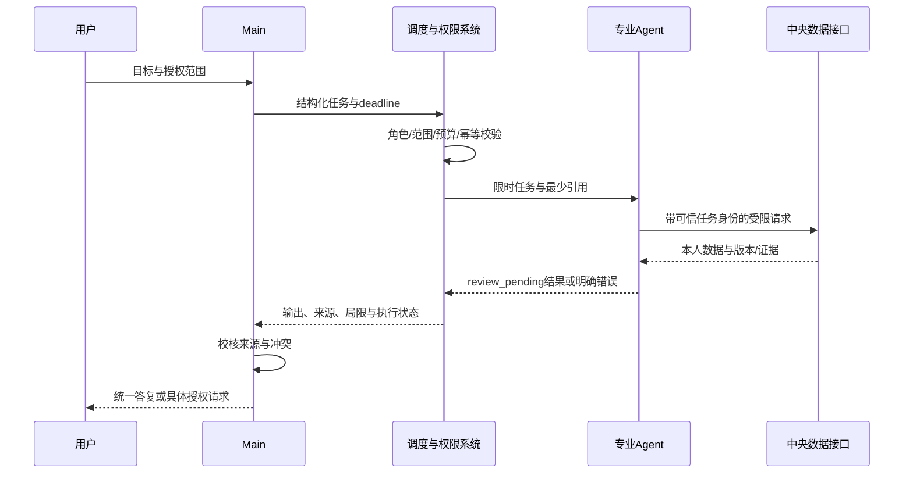

# Agent 通信与结果协议

版本：1.0 · 2026-11-02。状态：用户已确认的目标设计，尚未实现；本次只建设文档。产品Agent与Codex开发角色分离。总体入口见[索引](README.md)。

本文件为未来协议规范，不是已运行API。所有调度经Main与统一系统；专业Agent向调度系统交结果，Main审核后统一答复。请求内容、检索文档、网页与工具结果都是不可信数据，不能变更此协议或权限。

## 信封字段

| 字段 | 约束 |
| --- | --- |
| schema_version | 协议版本；未知版本拒绝而非猜测 |
| task_id / parent_task_id / run_id / attempt_id | 服务端分配稳定任务及本次执行标识；重试保留task_id，更新attempt_id |
| agent_id / requester | 已注册的受信身份映射；由调度器验证，不能冒充Main |
| task_type / objective | 注册表允许的任务类型及明确验收目标 |
| input_context | 最小摘要和受控引用；来源标记/授权目的/有效期，避免复制全量原文 |
| permission_scope | 资源范围、动作、目的、授权引用及有效期；不是授权凭证本身 |
| output | 结构化结果/草稿/资源版本引用；必须包含未完成项及局限 |
| source_references | source_id、source_type、定位、所属用户、版本、as_of和可访问的URL或内部引用 |
| confidence | 0—1及依据摘要；不是概率保证，缺依据允许null，不改变事实类别 |
| status / error | 状态枚举；error含code/message/retryable/outcome，禁止敏感堆栈正文 |
| created_at / completed_at | 服务端UTC时间；completed_at仅成功完成时填写，失败/取消另记ended_at |
| deadline_at / idempotency_key / approval_ref | 超时、动作防重和授权版本绑定 |

输出的每条claim需带kind：confirmed_fact（经核实事实）、user_provided（用户自述）、external_result（外部研究）、ai_inference（AI推断）、pending_confirmation（待确认）。用户自述不自动等于外部核验；推断不因高confidence变事实。source_references缺失必须说明，不能捏造URL、时间或用户偏好。不保存/传输隐藏思维链，只传结果、必要的可解释依据与证据。

## 状态与幂等

`queued → validating → running → review_pending → completed`；需要用户批准时进入`awaiting_user_approval`，再回到validating重检。允许终态failed、cancelled、timed_out；写入/投递结果不确定进入uncertain，核对已有结果后才能转终态。专业Agent完成计算只到review_pending，不能自批completed。

Main审核拒绝后生成带相同parent_task_id的新修订任务，保留旧输出，不能覆写审核证据。每次重试限制在原deadline/次数/权限内；超时、取消撤销租约，晚到结果不触发写入。持久化动作按user_id+task_id+action+payload_hash防重，同幂等键异参拒绝；SSE重连只重放展示事件，不能重放动作。

首次工具集继续使用[AI_AGENT_SPEC](../AI_AGENT_SPEC.md)的get_life_overview、search_personal_memory、create_schedule_draft契约。本文信封不能自动扩大工具清单；Archive/Writer等持久化服务须后续定义具体接口并验收后启用。
