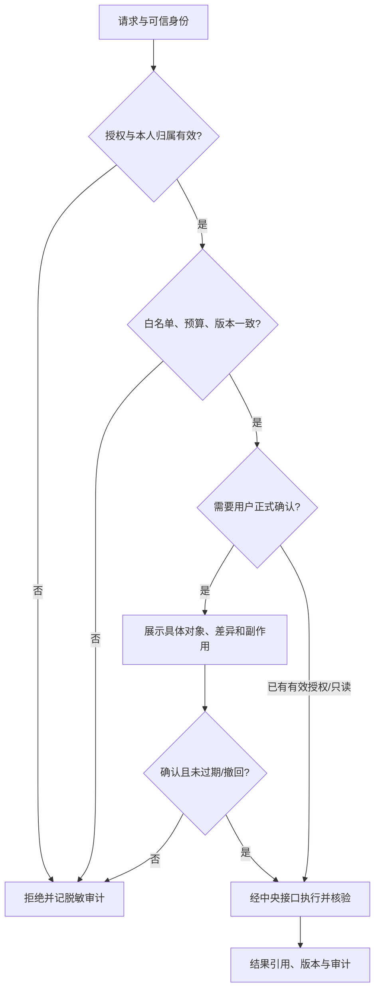

# Agent 权限与强制执行

版本：1.0 · 2026-11-02。状态：用户已确认的目标设计，尚未实现；本次只建设文档。产品Agent与Codex开发角色分离。总体入口见[索引](README.md)。

默认拒绝、最小必要、按任务限时授权。身份从服务端已验证会话注入；agent_id、requester和permission_scope是声明，不能用模型自报字段授权。所有数据、检索、SSE、后台工作、缓存、导出都限定同一user_id，跨表引用也检查归属。

| 身份 | 读取 | 创建/追加 | 修改 | 删除/外部副作用 |
| --- | --- | --- | --- | --- |
| Main | 用户获准范围与任务结果 | 任务、审核决定、统一答复 | 仅调度状态/经授权配置版本 | 无直接原数据删除；正式业务变更仍需用户授权 |
| User Information | 本人已授权资料/记忆/业务摘要 | 无 | 无 | 无 |
| Conversation Archive | 本人授权原文/摘要/来源 | 受保护原文追加、摘要/索引版本、候选记忆 | 新版本纠正摘要；不改原消息 | 不自行删原文或发布长期事实 |
| Knowledge Writer | 本人获准资料/研究/草稿 | 文档与计划草稿 | 审核+用户授权+版本匹配后保存正式新版本 | 不删原资料；不直接执行日程/通知 |
| External Research | 允许的公开资源和最少任务背景 | 研究区引用/草稿 | 研究更正版本 | 禁止隐蔽上传个人上下文；不改用户事实 |
| Proactive | 启用且允许范围的摘要/目标 | 交流提议与必要执行元数据 | 提议撤回/修订 | 不直接发送、改资料或绕开额度 |
| 数据/调度/网关服务（非Agent） | 验证后的最小范围 | 在代理授权下持久化、投递、审计 | 事务版本检查 | 用户明确请求的删除/导出由专用服务执行 |

表中的写入是逻辑权限，只能调用中央接口；不是数据库凭据。健康、财务及私人聊天需单独数据范围授权；管理员没有默认私文权限。所有角色禁止任意SQL、系统命令、未允许URL、读密钥或获取永久全库凭据；公开研究内容也按不可信输入处理。

## 审批与撤回

1. 检查会话/用户状态、角色注册版本和所需数据类别。
2. 匹配用户consent、资源归属与版本、目的、工具白名单及预算。
3. 正式写入和高影响动作绑定user_id、task_id、规范化参数哈希、资源版本、动作、有效期、approval_id；用户确认后参数变化必须重新审批。
4. Main的技术审核与用户授权分别留痕；用户已授权的同一范围不反复索要确认，范围扩大不能复用旧许可。
5. 执行前重新检查；撤回、暂停、过期或账号停用则取消排队任务。结果不确定先查状态，禁止盲重试。

任务日志不存正文、密钥或隐藏推理。专门的Conversation Archive可在用户授权后保存完整可见对话，这与工作日志最小化是不同数据区。用户删除/导出不由某个Agent任意操作，由身份与归属验证的服务统一处理；见[数据生命周期](MEMORY_AND_DATA_ARCHITECTURE.md)。
