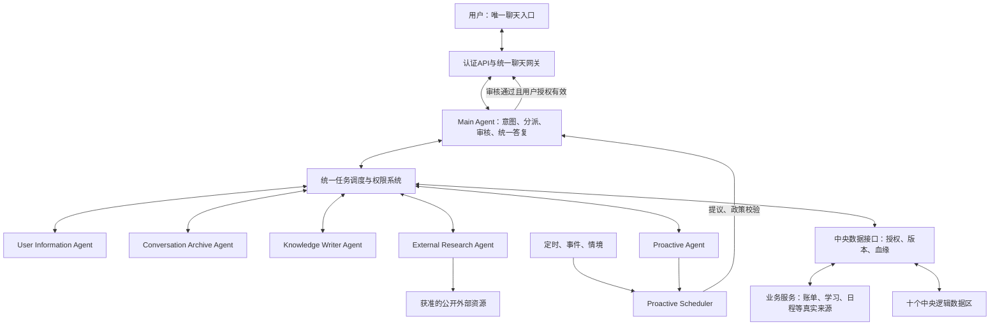
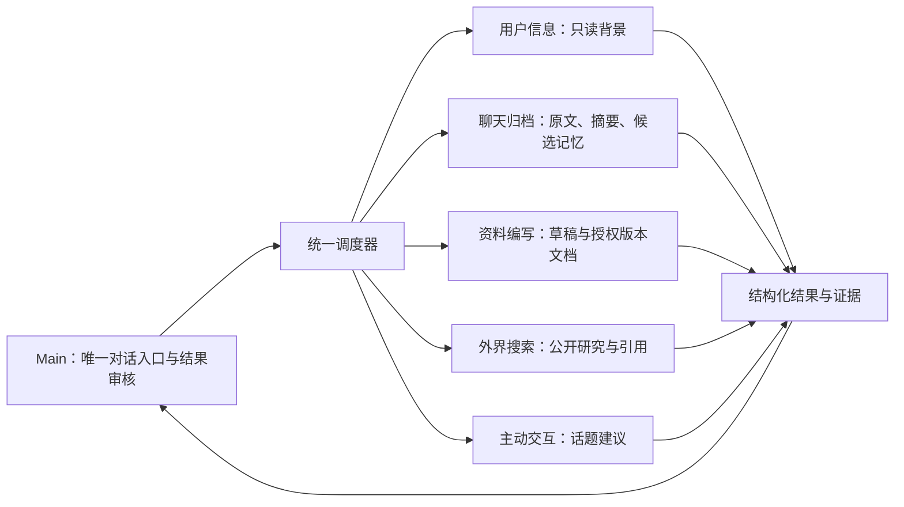

# AI 总体架构

版本：1.0 · 2026-11-02。状态：用户已确认的目标设计，尚未实现；本次只建设文档。产品Agent与Codex开发角色分离。总体入口见[索引](README.md)。

## 现状与设计边界

当前证据：app.js使用十个业务localStorage键；ideas-rich.js:40定义妙想IndexedDB；server/static_server.py是静态服务，server/notion_service.py的OperationLedger仅为可选Notion操作去重。PWA资源存在；助手入口无已接通的产品AI。现有存储不提供服务端账号隔离。本次不改现有ID、USD、统计、JSON v11或真实数据。

目标：一个Main Agent、五个专业Agent、统一调度与权限系统。开发SQLite/生产PostgreSQL、FastAPI优先、DeepSeek适配、SSE及APScheduler沿用既有目标；具体版本/模型/托管仍待验证。本图是目标组件关系，不是已部署拓扑。

网关和数据服务负责执行，不是新增人格Agent；Proactive Scheduler是统一调度系统内独立组件。所有内部调用由Main发起的调度任务承载，专业Agent不能点对点调用、扩权或自行发最终答复。专业结果返回Main，前端只展示Main批准内容；工具进度也经统一入口并标注状态。

## 六角色协作

主脑拥有任务调度和最终内容审核权；用户拥有权限、业务变更、正式保存与主动交互控制的最终决定权。Main不能批准自己没有的权限，管理员管理邀请也不获得私人正文访问权。

## 与旧规范的整合及冲突处置

| 差异/冲突 | 本次文档解决方式 | 实现门槛 |
| --- | --- | --- |
| 本地单人存储与中央多用户数据目标 | 逻辑分区映射既有DATA_MODEL，不迁移/新建表 | 认证隔离、迁移预览与恢复另立任务 |
| 旧AI规范笼统单助手与六角色 | 保留三个首期工具契约，在其上细化职责和统一调度 | 专业Agent不自动新增工具或权限 |
| Main最终决定与用户确认 | Main审内容，用户授权正式写入/高影响操作 | 绑定资源版本、参数哈希及有效期 |
| 完整聊天保留与日志最小化/用户删除 | 原文在受保护聊天区；工作日志仅元数据；摘要不覆盖原文 | 用户删除流程含索引/缓存/备份到期治理 |
| 主动发起与唯一入口 | Proactive只提议，Main审核，经同一网关发送 | 用户启用、统一配额、发送前重检 |
| 现有固定浅色/USD/周一起始日与用户时区策略 | 本次只定义未来AI时区策略，不增加现有设置字段 | 缺失有效时区则暂停主动发送 |
| 产品Agent与开发三角色 | 两套身份、权限、通信契约分离 | 开发Reviewer不充当产品Main |
| 旧CODEX文档的“仅七文档”任务限制 | 历史说明保留；本次按用户新任务授权扩展 | 不推广为未来通用例外 |

未解决的实施选择：身份提供方、托管与区域、真实模型/费用、保留期限、时区变更策略的用户体验、跨设备投递渠道、后台可靠发送。缺失这些信息不阻碍完成文档，但禁止写成能力已上线。
