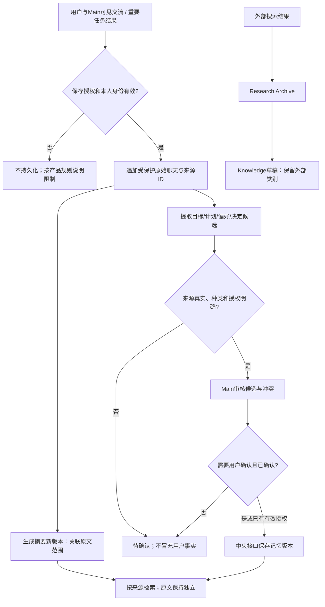

# 中央数据、记忆与原始记录

版本：1.0 · 2026-11-02。状态：用户已确认的目标设计，尚未实现；本次只建设文档。产品Agent与Codex开发角色分离。总体入口见[索引](README.md)。

中央数据层是统一授权/血缘/版本的逻辑访问层，不是把全部数据复制进同一“超级记忆”。业务模块仍为学习、财务、健康、日程等事实真源；Agent仅通过授权中央接口访问，临时上下文缓存可存在，但不能成为互不相通的权威个人记忆。

## 十个逻辑区域与既有模型映射

| 区域 | 内容/现有目标映射 | 写入与保护 |
| --- | --- | --- |
| User Profile | profiles及获准业务事实引用 | 用户或获准业务服务管理；User Information只读 |
| User Memory | personal_memories | 候选/确认/待确认分层，来源和有效期必须保留 |
| Conversation Archive | conversations/messages，重要Agent任务/结果引用 | 统一网关捕获完整可见用户/Main消息，原文追加，不让摘要改写 |
| Conversation Summary | 原会话摘要版本逻辑区，旧模型尚未专门细化 | 派生可重建；必须关联原文范围和摘要版本 |
| Knowledge Base | 来源化知识条目逻辑区，尚未定义表 | Writer草稿/Main审核；外部内容不自动转个人事实 |
| Documents | 正式文档及版本逻辑区 | 正式保存需有效授权和版本检查，旧版本保留 |
| Research Archive | 公开外部引用/抓取摘要逻辑区 | Research提供来源/时间/可信度，独立于用户个人记忆 |
| Agent Logs | ai_runs/tool_calls/audit_events | 脱敏元数据；不默认记录私人正文 |
| Proactive Logs | scheduled_jobs关联投递/配额逻辑区 | 同一用户统一账本，控制权见主动规范 |
| Agent Tasks | ai_runs及任务/attempt逻辑区 | 调度系统维护状态和幂等/审核引用 |

这是逻辑映射，不新增DDL或暗示当前数据库已有十区；摘要、知识、文档、研究、投递配额及任务细化字段在实际开发前同步DATA_MODEL并评审，不自动往本地JSON v11追加字段。

## 统一接口与来源

接口能力族：受限read/search、append原文、保存派生版本、创建草稿、reviewed publish、用户授权export/delete；名字只是逻辑能力，不是已实现HTTP路径。可信服务端上下文注入user_id/agent/task/consent；字段白名单、目的与归属在每次查询、搜索、向量过滤、关联和缓存命中前执行，禁止先全库检索再过滤。

每条数据保留：稳定id/所属用户、类别、版本、created_at/updated_at、来源引用及来源版本、生成者、确认状态、有效期/撤回状态、授权目的。记忆另有fact_kind、confidence与依据；业务真源变化使派生记忆失效/重建。用户自述、已确认事实、外部研究、推断和待确认内容不能混存为一个不带标记的事实字段。

## 保存与提取流程

原文完整保留指已经授权归档的完整可见内容，不包括隐藏思维链、令牌或系统秘密。摘要/记忆不可覆盖、删节原消息；外部网页和工具结果不得假装用户说过。无需确认的常规派生索引也受既有范围授权，不能借“自动归档”无限采集。

## 版本、重复与用户权利

- 消息按user_id+conversation_id+sequence或稳定message_id防重；同键不同内容报冲突，不静默覆盖。来源内容修改通过更正事件和版本关系表示，业务记录的ID/原意保持。
- 摘要以source_range+source_versions+summary_version追溯；候选记忆按来源和规范化claim去重，语义相似不代表相同事实；冲突保留各版本、来源和待确认状态。
- 用户可查看、导出、更正、删除及关闭记忆。删除服务校验身份/范围，传播至摘要/向量索引/缓存/待发送任务/后续上下文；长对话上下文须重建，不能继续沿用已删正文。保留必要非正文删除标记以防恢复旧备份后复活。
- 原始记录保护是禁止Agent自行覆盖/删除，不剥夺用户删除或注销权。删除后按经批准的留存策略处理备份、日志和源文；保留期限尚待确认，不承诺无限保留或即时抹除所有离线备份。需要长期原文时也不能绕过用户撤回。
- 备份需覆盖逻辑记录、附件、版本、来源链、权限策略、任务/投递幂等与删除标记，避免恢复后重复执行或恢复已撤回授权。密钥由独立安全机制管理，不混入文档/Git。先隔离恢复校验引用与归属，再按明确授权切换；不覆盖新增真实数据。
- 当前源码Git备份不包含用户浏览器数据，完整JSON v11也不自动包含未来AI区域。现有IDB/localStorage不是多用户中央库；迁移另立范围、预览和恢复演练，绝不本轮操作。
