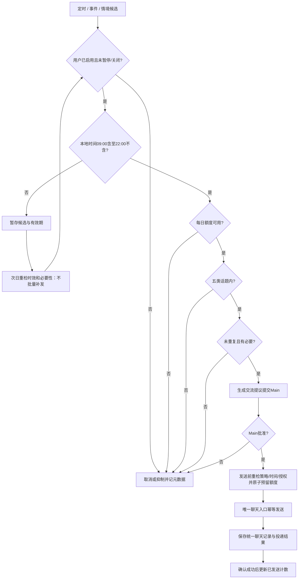

# Proactive Agent 与主动交流调度器

版本：1.0 · 2026-11-02。状态：用户已确认的目标设计，尚未实现；本次只建设文档。产品Agent与Codex开发角色分离。总体入口见[索引](README.md)。

## 已确认初始策略（唯一参数源）

| 项目 | 已确认规则 |
| --- | --- |
| 每日最大次数 | 每位用户每天最多 **3次**；全部触发/Agent/设备共用 |
| 时间窗口 | 用户Life OS本地时区 **09:00—22:00**，精确定义为[09:00,22:00) |
| 五类话题 | **生活交流、学习跟进、目标管理、新知识分享、日常问候**，不得扩大 |
| 出口 | Proactive提议 → Scheduler校验 → Main审核 → 唯一聊天网关发送 → 统一聊天归档 |

用户已经确认上述初始配置；这不表示本次启用后台发送。实际启用须有用户可撤回的授权和已验收运行能力。用户可暂停、恢复、永久关闭及调整每日次数/时间/话题；调整必须来自明确用户操作或确认，形成新策略版本，Agent不能自改。永久关闭后任务不自动恢复，重新启用必须由用户明确操作。

### 计数定义

主动开启一个新话题/新对话计1次；用户主动发起不计，已经开始的对话正常连续回复不重复计数。不得通过新Agent、定时/事件/情境切换、设备或重试绕过额度；后续无关新话题仍计新次数。额度是上限，不是每天必须发满的目标。

09:00前禁止，09:00整允许，21:59仍须全部检查，22:00整禁止新主动发送。用户在22:00后继续已开启对话的正常回复不属于主动开新话题。排队或Main在21:59批准不等于22:00后仍可发送。

## 三种触发与优先级

| 类型 | 范围内的例子 |
| --- | --- |
| 定时 | 早间问候、日常交流、学习/计划回顾 |
| 事件 | 重要计划到期、学习进度变化、目标长期未更新、用户明确要求跟进事项 |
| 情境 | 有价值的新知识、与当前项目相关的新技术、值得关注的信息 |

触发器只产生候选；事件/技术并不自动成为新话题类别，必须映射五类之一。显式跟进与有时效的获准计划优先于泛化分享/问候；同类按有效期、相关性、重复程度排序，具体权重和冷却时长待验证，未定前不自动启用。用户已在同一主题交谈时合并/抑制提议，不能再开一条抢占用户对话。

## Proactive Scheduler

属于统一调度系统的独立组件，负责时间/每日额度/话题/重复检查、用户暂停状态、优先级、暂存、Main审核请求和主动交流日志。所有触发路径都必须经过它。

Main审核可建议修订，但修订后再次检查话题/去重/授权；Main不能豁免额度或时间。非窗口普通候选只暂存，次日若过期/已讨论/无必要则丢弃；同一日积压不得机械补发。

## 并发、投递与时区

- 配额键至少包含可信user_id、本地业务日期、策略版本关联；跨版本查询同一用户当天已发送及未决预留总量，策略变化不能清零已用额度。默认已发送+活跃预留≤3，以同一权威存储的事务/锁或等价原子机制实现；不是每个Agent各自计数。
- 发送前预留避免并发超额；确认成功才计入已发送，明确失败释放预留；结果未知保留预留并查投递状态，禁止直接释放后重发。用户可见消息和归档以同一delivery_id幂等关联，发送成功归档失败须补记归档而不重发；事务outbox/等价机制的具体实现另定。
- Main批准后发送前再次检查窗口、授权、暂停状态、剩余额度、重复、有效期和策略版本。重试沿用delivery_id/topic_key，同一实际投递不重复计数。
- 使用用户设置的有效IANA时区，存UTC时间+本地日期+时区快照；缺失/无效时区暂停主动发送并由正常用户交互补齐。夏令时重复时段仍按本地日总额度；跨设备共用服务器账本。时区变更不得授予第二份当日额度，过渡日采用不增加剩余额度的保守账本映射，具体迁移/跨日边界方案先评审再实现。
- 定时器不等于系统推送能力。离线/不可达时不得当作已交流；旧候选下一允许窗口重新评估。初期只走同一聊天入口，不新增第二聊天界面或外部推送渠道。

日志至少包含trigger_type、topic_category、topic_key、source_refs、policy_version、scheduled_at、decision_reason、main_approval_ref、delivery_id、quota_state、outcome。日志仅元数据；交流正文保存在受保护Conversation Archive。

## 用户控制与验收

预留暂停/恢复/永久关闭、调整次数/时间/五类中的允许话题、查看交流记录入口；本次不新增前端开关。关闭/暂停撤销待发租约和任务，不能仅隐藏设置按钮。扩大五类范围或改变角色职责须先更新本规范并确认。

后续必测：08:59拒绝/09:00允许/22:00拒绝；第4次拒绝；三类触发和多个Agent并发共享额度；用户主动与连续回复不计；发送前暂停/撤权/跨窗口生效；失败/未知投递不重复；策略/时区变更不重置额度；次日过期候选丢弃；全部实际交流进入同一归档。本次未运行以上产品测试。
